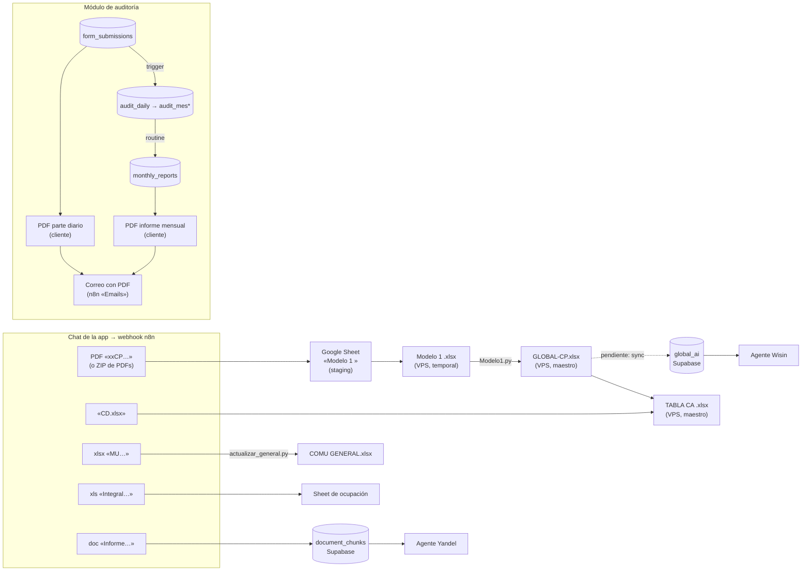

# Generación de documentos

Qué documentos produce Polarier, de qué ficheros sale cada uno y qué reglas hay que respetar para que se generen bien. Es el **contrato** entre quien sube ficheros, n8n, los scripts del VPS, Supabase y la app. Antes de tocar un flujo que lea o escriba documentos, lee esta nota; si cambias algo de lo que aquí se describe, actualízala.

> Mapa sacado el 2026-10-12 del workflow **"Polarier Auto App"** (`BQoya6xrMaF1UAkU`, versión activa `53dec2de`), de los scripts del VPS y del código de la app. Detalle técnico de n8n en [[Integracion-n8n]]; del módulo de auditoría en [[Modulo-Auditoria]] y [[Routine-Informe-Mensual]].

---

## Mapa de dependencias

---

## Reglas generales

### 1. El nombre del fichero es el contrato

En el chat, **el nombre del fichero subido decide qué documento se genera**. `Switch3` compara por subcadena (`contains`) y en modo *primera coincidencia*, en este orden:

| Orden | Si el nombre contiene… | Rama | Estado |
|---|---|---|---|
| 0 | `MU` | Carla → COMU GENERAL | **Rota a propósito** (decisión 2026-10-05) |
| 1 | `CP` | Leslie → GLOBAL-CP | Operativa |
| 2 | `Integral` | Ocupación | Funciona, **no se usa** |
| 3 | *(mime zip)* | Lote de PDFs CP → GLOBAL-CP | Operativa |
| 4 | `Informe` | Base de conocimiento | Operativa |
| — | nada de lo anterior / audio | Agente Benjamin (texto, imagen o audio) | Operativa |

Consecuencias que hay que respetar:

- Un fichero que contenga **dos** marcadores va a la **primera** rama. Un `CP` cuyo nombre lleve `MU` acaba en la rama Carla.
- **Ningún valor de regla puede ser subcadena de otro** en un mismo switch. Esto ya provocó pérdida silenciosa de datos (ver [[Integracion-n8n]], `Switch4`/`Switch5`).
- Las comparaciones distinguen mayúsculas.
- Una rama nueva (p. ej. `CD`) necesita una marca que no aparezca en los nombres de las demás ramas.

### 2. Códigos de polo

Cada sistema heredado usa su propio código. **No hay un código único**: esta tabla es la referencia para traducir entre ellos.

| Polo | PDF CP | Fichero MU | Hoja en GLOBAL | Fichero CD | Hoja en TABLA CA | Texto dentro del PDF (ZIP) | Sheet de staging |
|---|---|---|---|---|---|---|---|
| Holguín | `HOCP` | `HO` | `HOLCP<año>` | `HOLCD` | `HOLGUÍN` | `HOLGUIN` | Modelo 1 Holguin |
| Varadero | `VACP` | `VA` | `VARCP<año>` | `VACD` | `VARADERO` | `Varadero` | Modelo 1 Varadero |
| Caibarién | `CACP` | `CA` | `CACP<año>` | `CACD` | `CAIBARIEN` | `Centro` | Modelo 1 Caibarien |
| La Habana | `HACP` | `HA` | `LHCP<año>` | `LHCD` | `HABANA` | `Aster` | Modelo 1 Habana |
| Cayo Cruz | `CXCP` | `CX` | `CCZCP<año>` | `CCXCD` | `CAYOCRUZ` | `Cruz` | Modelo 1 Cayo Cruz |
| Cayo Coco | `CCCP` | `CC` | `CCCP<año>` | `CCCD` | `CAYOCOCO␣` (con espacio final) | `Coco` | Modelo 1 Cayo Coco |

Ojo con los que no son obvios: Habana es `HA` en los PDF pero `LH` en el GLOBAL y en CD. Cayo Cruz es `CX`, `CCZ` o `CCX` según el sistema. En los PDF de un ZIP, Caibarién aparece como «Centro» y La Habana como «Aster».

### 3. Maestros: dónde viven y quién los toca

| Maestro | Dónde vive (fuente de verdad) | Quién lo escribe | Copias |
|---|---|---|---|
| `GLOBAL-CP<aa>.xlsx` | VPS `/data/Polarier/Leslie/` | `Modelo1.py` (lo sobrescribe en cada pasada) | Drive, carpeta «Modelo 1», como `GLOBALCP-26.xlsx`: **solo** se refresca por la rama ZIP |
| `TABLA CA <año>.xlsx` | VPS `/data/Polarier/Leslie/CD/` | Rama CD (en rediseño) | — |
| `COMU <MES> GENERAL.xlsx` | VPS `/data/Polarier/Carla/` | `actualizar_general.py` | — |
| Sheets «Modelo 1 <polo>» | Google Drive | Rama CP (appendOrUpdate) | Son **staging**: se vacían al terminar |
| `global_ai` | Supabase | Hoy: carga única del 2026-08-30 | Ver documento D6 |
| `document_chunks` | Supabase | Rama `Informe` | — |

- **Los scripts y maestros del VPS mandan.** Las copias de `C:\Trabajo\N8N\Polarier\` son de referencia y pueden estar desfasadas (p. ej. `Leslie/Modelo1.py` y `Leslie Global 2025/Modelo1.py` ya no coinciden).
- El VPS se monta en el contenedor n8n como `/data/Polarier/` (subcarpetas `Carla`, `Leslie`, `Leslie Global 2025`, `python-runner`).

### 4. El año sale del fichero

**Decisión (2026-10-12):** el año de trabajo se deduce del fichero subido (`CACD202510` → 2025; un PDF CP de octubre/2026 → `GLOBAL-CP26`, hojas `*CP2026`). Un año nuevo crea su maestro a partir de una plantilla. **Nada de años fijos en nodos ni en scripts.**

**Estado actual (aún sin implantar):** el año va fijo en varios sitios, que hay que cambiar cada enero mientras no se aplique la regla:

- `Modelo1.py`: `GLOBAL-CP26.xlsx` y el mapa `*CP2026`.
- n8n: `Read/Write Files from Disk4`/`5` leen `GLOBAL-CP26.xlsx`, y `Upload file` sube `GLOBALCP-26.xlsx`.
- `rellenar_ca.py`: `TABLA CA 2025.xlsx` y el mapa `*CP2025`, que **no casa** con el `GLOBAL-CP26` que lee. Por eso no funcionaría aunque se ejecutara.

### 5. Formatos

- **Excel:** siempre `.xlsx` real (OOXML). Al bajar un Google Sheet desde Drive hay que forzar `googleFileConversion → application/vnd.openxmlformats-officedocument.spreadsheetml.sheet`: sin eso Drive exporta **ODS con extensión `.xlsx`** y openpyxl revienta.
- **PDF de la app:** jsPDF en el navegador. El nombre es `slug(título)-AAAA-MM-DD.pdf` (`nombreArchivoInforme` en `src/lib/informe.ts`).
- **Correo:** el PDF viaja como base64 en `adjunto.base64` y n8n lo convierte en binario.
- **Respuesta al chat:** si es un fichero, binario con `Content-Disposition: attachment; filename="…"` y `Access-Control-Expose-Headers: Content-Disposition`. Si es texto, en una clave que la app reconozca (`respuesta`, `output`…). Ver [[Integracion-n8n]].

### 6. Cómo se ejecuta Python

El contenedor n8n **no tiene Python**. Todo script se lanza con `POST http://polarierauto_pythonrunner:8000/run` y `{ "script": "<carpeta>/<script>.py", "args": [] }`. La respuesta trae `stdout`/`stderr`. **Nunca** con `Execute Command`: los nodos que aún lo usan son la deuda de la rama Carla.

### 7. Agentes y datos

- Un agente **no inventa cifras**. Si un dato no está, lo dice. Esto vale para Benjamin, Wisin, Yandel, la routine del informe mensual y el futuro agente de la TABLA CA.
- Los números de los informes de auditoría los calcula **SQL**. La IA solo redacta (ver [[Routine-Informe-Mensual]]).
- Un agente que rellena un documento devuelve **cada valor con la celda de la que salió**, y un nodo comprueba las sumas obvias antes de escribir.

---

## Catálogo de documentos

### D1 — GLOBAL-CP\<aa\>.xlsx (cuenta de resultados por polo)

- **Se dispara:** al subir un PDF cuyo nombre contiene `CP` y el código del polo (`HOCP`, `VACP`, `CACP`, `HACP`, `CXCP`, `CCCP`), o un **ZIP** con varios de esos PDF.
- **Entrada:** PDF del modelo CP. Del texto se extraen la lavandería (`Lavanderia <NOMBRE>`), el mes (`<Mes>/<AAAA>`) y las filas `ccc Indicador PM RM PA RA %M %A`, con el código de 3 dígitos. Lo hace `Code in JavaScript1`.
- **Proceso:**
  1. Las filas se vuelcan (appendOrUpdate) en el Sheet «Modelo 1 \<polo\>» de Drive.
  2. El Sheet se baja como xlsx a `/data/Polarier/Leslie/Modelo 1 <polo>.xlsx`.
  3. `Leslie/Modelo1.py` (sin argumentos) coge **el `Modelo 1 *.xlsx` más reciente por fecha de modificación**. Localiza en la hoja `<COD>CP<año>` del GLOBAL el mes (fila 4) y sus columnas PLAN/REAL (fila 5), casa por código (columna `Filas`) o por indicador, sobrescribe el GLOBAL y **borra el Modelo 1**.
  4. Se vacía el Sheet de staging.
- **Rama ZIP:** se procesa PDF a PDF (`Loop Over Items`), deduciendo el polo por el texto del PDF. Al terminar, **sustituye la copia del GLOBAL en Drive** (busca, borra y sube `GLOBALCP-26.xlsx`).
- **Sale:** `GLOBAL-CP26.xlsx` como binario en el chat.
- **Fallos conocidos:**
  - El PDF suelto **no** refresca la copia de Drive; solo lo hace el ZIP.
  - `Search files and folders` busca `GLOBAL` en **todo** el Drive y `Delete a file` borra **todo** lo que encuentre, incluido un posible `GLOBAL-CP25`.
  - Como el script elige el Modelo 1 «más reciente», dos subidas simultáneas pueden cruzarse.
  - Varios `Delete rows…` usan `numberToDelete` fuera de INT32 (ver [[Pendientes]]).

### D2 — TABLA CA \<año\>.xlsx (indicadores mensuales por lavandería)

- **Se dispara (diseño 2026-10-12, sin implantar):** al subir `<LAV>CD<AAAAMM>.xlsx`, p. ej. `CACD202510.xlsx` (patrón `^[A-Za-z]+\d{4}\d{2}$`; prefijos en la tabla de polos).
- **Entradas:**
  - El fichero CD, con las hojas **Economía, Producción, RRHH, Transporte, SSTT y Calidad** (el nombre exacto varía, se buscan de forma aproximada).
  - El **GLOBAL** del año, hoja `<COD>CP<año>`.
  - La plantilla `TABLA CA <año>.xlsx`: cabecera de meses en la fila 5, claves en la columna A desde la fila 6, y un segundo bloque repetido para el año anterior, que **no** se toca.
- **Sale:** la columna del mes, en la hoja del polo, con **28 indicadores**.
  - **Del CD:** turistas días, producción kg, prendas procesadas, ingresos por alquiler de lencería, por lavado y otros, días y horas trabajadas, promedio de trabajadores, trabajadores productivos, vehículos (totales y propios), km, diésel de transporte, CDT/CDO de equipos, diésel de producción, electricidad, agua, capacidad instalada por hora y evaluación de calidad.
  - **Del GLOBAL:** costo de lavandería, gastos totales (fijos + indirectos), utilidad en operaciones (antes de cargo fijo), utilidad neta (antes de impuestos), gasto de salario y **VAB**.
  - **Calculados:** `REAL INGRESOS = alquiler + lavado + otros`.
  - El VAB se calcula sobre códigos de fila (`Filas`) del GLOBAL: 30 − 69 − 77 − 93 − 129 − 112 − 115 − 121 − 136 − 176 − 177 − 178 − 180 − 182 − 198 + 144 − 113 − 114 − 116 − 117 − 123 − 181 − 195 − 200. Son **códigos de fila**, no números de fila de Excel, y coinciden con `global_ai.codigo_fila`.
- **Antes:** `Leslie/CD/rellenar_ca.py --archivo_cd <fichero>`. Buscaba las etiquetas con desplazamientos fijos (`+2 columnas`), así que se rompía con cualquier cambio de formato.
- **Decisión (2026-10-12):** lo hace **un agente de n8n**: lee el CD y el Global (vía `global_ai`), y decide los 28 valores, cada uno con su celda de origen. Un nodo valida las sumas, y un escritor genérico en el pythonrunner (openpyxl) escribe la columna del mes sin tocar el formato. **Maestro en el VPS** y el chat devuelve el xlsx. La **TABLA CA 2026 aún no existe**: Leo la subirá al VPS cuando se la den.

### D3 — COMU \<MES\> GENERAL.xlsx (Carla)

- **Se dispara:** fichero con `MU` en el nombre: `<PROV>MU…`, renombrado a `<PROV>MUS<semana>.xlsx`, con la semana `S1`–`S5`.
- **Proceso:** `Carla/actualizar_general.py` (sin argumentos) busca en su carpeta el fichero con `GENERAL` en el nombre y los provinciales por prefijo. Pasa por cuatro fases (normalizar, planificar, auditar y aplicar) y solo escribe si la auditoría aprueba.
- **Estado: rota en producción, por decisión (2026-10-05).** Falla en silencio hacia `error3`. Qué haría falta para retomarla: ver [[Integracion-n8n]].

### D4 — Ocupación hotelera (rama `Integral`)

- **Se dispara:** fichero xls con `Integral` en el nombre.
- **Proceso:** lee las filas, se queda con las provincias permitidas y las renombra a polo (La Habana → Habana, Matanzas → Varadero, Villa Clara → Caibarién, Ciego de Ávila → Cayo Coco, Camagüey → Cayo Cruz). Añade filas al Google Sheet **«Prueba»** y devuelve ese Sheet como xlsx.
- **Estado:** funciona, pero **no se usa**. Se deja tal cual (decisión 2026-10-12).

### D5 — Base de conocimiento de informes mensuales

- **Se dispara:** documento con `Informe` en el nombre.
- **Proceso:** se trocea y se vectoriza en `document_chunks` (Supabase). El chat responde «El documento de Informe se subio correctamente».
- **Lo consume:** Yandel (subagente de Benjamin), con `match_documents`.

### D6 — global_ai (Global normalizado en Supabase)

- **Qué es:** una fila por año × hoja × periodo × partida, con plan/real/Qp/desviación, la celda de origen y `codigo_fila`. La clave es determinista: `row_uid = "<año>|<hoja>|<AAAA-MM>|<codigo_fila>|<metric_path_key>"`, así que se puede volver a cargar con un upsert sin duplicar.
- **Lo consume:** Wisin (herramientas `global_ai_dato_exacto`, `global_ai_polo_periodo`, `global_ai_comparar_partida`) y, en el diseño nuevo, el agente de la TABLA CA.
- **Estado:** carga **única** del 2026-08-30 (6 hojas, enero–junio 2026, 2.313 filas). No se sabe qué la cargó y `global_import_runs` está vacía. **Desactualizada**: el GLOBAL del VPS ya tiene más meses.
- **Decisión (2026-10-12):** al terminar cada Modelo 1, se normaliza la hoja del polo actualizada y se hace upsert en `global_ai` (registrando la pasada en `global_import_runs`).

### D7 — PDF del parte diario de auditoría

- **Dónde:** en el navegador, sin n8n. `src/lib/informe.ts` (estructura) → `informePdf.ts` (jsPDF + autotable) → `InformePreview.tsx`.
- **Entrada:** una `form_submission` + su `form_definition` (+ catálogos y dotación, si es de lencería).
- **Sale:** `slug(título)-AAAA-MM-DD.pdf`.

### D8 — Informe mensual de auditoría

- **Texto:** lo escribe la routine de Claude en `monthly_reports.resumen`, leyendo solo `audit_mes`, `audit_mes_dias` y `audit_mes_dotacion`. Nunca `form_submissions` en crudo.
- **PDF:** en el cliente, reutilizando D7 vía `src/lib/informeMensual.ts`.
- **Sin uso:** `monthly_reports.pdf_url` y el bucket `informes-mensuales`.
- Detalle en [[Routine-Informe-Mensual]].

### D9 — Envío por correo

- **Dónde:** `EnviarCorreoModal` → `src/services/informeCorreo.ts` → webhook n8n.
- **Remitente:** cuenta fija, con `senderName` = usuario y `replyTo` = su email. No se puede enviar «desde» el usuario (ver [[Decisiones]]).
- **Decisión (2026-10-12):** el correo pasa al workflow **«Emails»** del n8n self-hosted (`TIwrYY0MIntv5GLj`) y se deja de usar el de n8n cloud (`automate-cuba24`, `Komb1YycRFKXTvkX`). A fecha de hoy la app **todavía** apunta al de cloud, y «Emails» no tiene ni una ejecución, así que hay que probarlo de punta a punta antes de cambiar.
