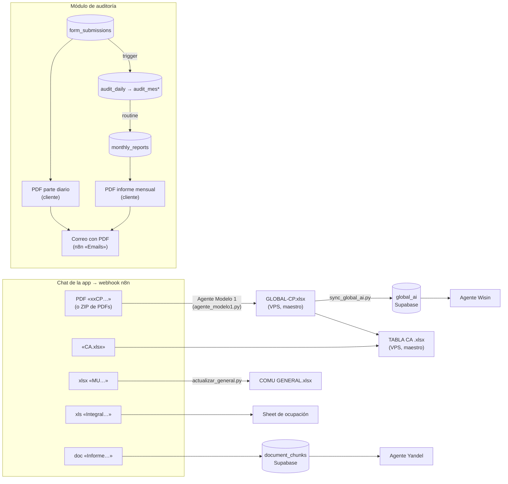

# Generación de documentos

Qué documentos produce Polarier, de qué ficheros sale cada uno y qué reglas hay que respetar para que se generen bien. Es el **contrato** entre quien sube ficheros, n8n, los scripts del VPS, Supabase y la app. Antes de tocar un flujo que lea o escriba documentos, lee esta nota; si cambias algo de lo que aquí se describe, actualízala.

> Mapa sacado el 2026-10-12 del workflow **"Polarier Auto App"** (`BQoya6xrMaF1UAkU`, versión activa `53dec2de`), de los scripts del VPS y del código de la app. Detalle técnico de n8n en [[Integracion-n8n]]; del módulo de auditoría en [[Modulo-Auditoria]] y [[Routine-Informe-Mensual]].

---

## Mapa de dependencias

---

## Reglas generales

### 1. El nombre del fichero es el contrato

En el chat, **el nombre del fichero subido decide qué documento se genera**. `Switch3` compara por subcadena (`contains`) y en modo *primera coincidencia*, en este orden:

| Orden | Si el nombre contiene… | Rama | Estado |
|---|---|---|---|
| 0 | `MU` | Carla → COMU GENERAL | **Rota a propósito** (decisión 2026-10-05) |
| 1 | regex sin distinguir mayúsculas: `<polo>CP….pdf`, `<polo>M-1….pdf`, `Mod 1…`, `Modelo 1…` o `Modelo I….pdf` (salida «Modelo 1») | **Agente Modelo 1** (ver D1) | Operativa (versión `9d0654b9`, 2026-10-15) |
| 2 | `Integral` | Ocupación | Funciona, **no se usa** |
| 3 | mime `zip`/`rar` o nombre `.zip`/`.rar`, sin distinguir mayúsculas (salida «Comprimido») | La misma rama que la salida 1. Dentro del comprimido el nombre no importa: el polo y el mes salen del contenido | Operativa |
| 4 | `Informe` | Base de conocimiento | Operativa |
| — | nada de lo anterior / audio | Agente Benjamin (texto, imagen o audio) | Operativa |

Consecuencias que hay que respetar:

- Un fichero que contenga **dos** marcadores va a la **primera** rama. Un `CP` cuyo nombre lleve `MU` acaba en la rama Carla.
- **Ningún valor de regla puede ser subcadena de otro** en un mismo switch. Esto ya provocó pérdida silenciosa de datos (ver [[Integracion-n8n]], `Switch4`/`Switch5`).
- Las reglas por subcadena (`MU`, `Integral`, `Informe`) distinguen mayúsculas.
- Las reglas por regex («Modelo 1», «Comprimido» y «Leslie CA») no las distinguen (`caseSensitive: false`), y por eso **su patrón tiene que ir en minúsculas**: n8n pasa a minúsculas el nombre del fichero, pero no el patrón.
- Una rama nueva (p. ej. `CD`) necesita una marca que no aparezca en los nombres de las demás ramas.

### 2. Códigos de polo

Cada sistema heredado usa su propio código. **No hay un código único**: esta tabla es la referencia para traducir entre ellos.

| Polo | PDF CP | Fichero MU | Hoja en GLOBAL | Fichero CA | Hoja en TABLA CA | Texto dentro del PDF (ZIP) | Sheet de staging |
|---|---|---|---|---|---|---|---|
| Holguín | `HOCP` | `HO` | `HOLCP<año>` | `HOCA` | `HOLGUÍN` | `HOLGUIN` | Modelo 1 Holguin |
| Varadero | `VACP` | `VA` | `VARCP<año>` | `VACA` | `VARADERO` | `Varadero` | Modelo 1 Varadero |
| Caibarién | `CACP` | `CA` | `CACP<año>` | `CACA` | `CAIBARIEN` | `Centro` | Modelo 1 Caibarien |
| La Habana | `HACP` | `HA` | `LHCP<año>` | `HACA` | `HABANA` | `Aster` | Modelo 1 Habana |
| Cayo Cruz | `CXCP` | `CX` | `CCZCP<año>` | `CXCA` | `CAYOCRUZ` | `Cruz` | Modelo 1 Cayo Cruz |
| Cayo Coco | `CCCP` | `CC` | `CCCP<año>` | `CCCA` | `CAYOCOCO` (en la 2025 llevaba espacio final) | `Coco` | Modelo 1 Cayo Coco |

Ojo con los que no son obvios: Habana es `HA` en los PDF pero `LH` en el GLOBAL y en CD. Cayo Cruz es `CX`, `CCZ` o `CCX` según el sistema. En los PDF de un ZIP, Caibarién aparece como «Centro» y La Habana como «Aster».

### 3. Maestros: dónde viven y quién los toca

| Maestro | Dónde vive (fuente de verdad) | Quién lo escribe | Copias |
|---|---|---|---|
| `GLOBAL-CP<aa>.xlsx` | VPS `/data/Polarier/Leslie/` (el de 2025, en `Leslie Global 2025/`) | `Modelo1.py` (lo sobrescribe en cada pasada). Con el rediseño, `agente_modelo1.py`, que guarda copia previa en `Leslie/respaldos_global/` (las 20 últimas) | Drive, carpeta «Modelo 1», como `GLOBALCP-26.xlsx`: **solo** se refresca por la rama ZIP. Con el rediseño **deja de actualizarse** (decisión 2026-10-14) |
| `TABLA CA <año>.xlsx` | VPS `/data/Polarier/Leslie/CD/` | Rama CD (en rediseño) | — |
| `COMU <MES> GENERAL.xlsx` | VPS `/data/Polarier/Carla/` | `actualizar_general.py` | — |
| Sheets «Modelo 1 <polo>» | Google Drive | Rama CP (appendOrUpdate) | Son **staging**: se vacían al terminar. **Desaparecen con el rediseño** |
| `global_ai` | Supabase | Hoy: carga única del 2026-08-30 | Ver documento D6 |
| `document_chunks` | Supabase | Rama `Informe` | — |

- **Los scripts y maestros del VPS mandan.** Las copias de `C:\Trabajo\N8N\Polarier\` son de referencia y pueden estar desfasadas (p. ej. `Leslie/Modelo1.py` y `Leslie Global 2025/Modelo1.py` ya no coinciden).
- El VPS se monta en el contenedor n8n como `/data/Polarier/` (subcarpetas `Carla`, `Leslie`, `Leslie Global 2025`, `python-runner`).

### 4. El año sale del fichero

**Decisión (2026-10-12):** el año de trabajo se deduce del fichero subido (`CACD202510` → 2025; un PDF CP de octubre/2026 → `GLOBAL-CP26`, hojas `*CP2026`). Un año nuevo crea su maestro a partir de una plantilla. **Nada de años fijos en nodos ni en scripts.**

**Estado actual (aún sin implantar):** el año va fijo en varios sitios, que hay que cambiar cada enero mientras no se aplique la regla:

- `Modelo1.py`: `GLOBAL-CP26.xlsx` y el mapa `*CP2026`.
- n8n: `Read/Write Files from Disk4`/`5` leen `GLOBAL-CP26.xlsx`, y `Upload file` sube `GLOBALCP-26.xlsx`.
- `rellenar_ca.py`: `TABLA CA 2025.xlsx` y el mapa `*CP2025`, que **no casa** con el `GLOBAL-CP26` que lee. Por eso no funcionaría aunque se ejecutara.

### 5. Formatos

- **Excel:** siempre `.xlsx` real (OOXML). Al bajar un Google Sheet desde Drive hay que forzar `googleFileConversion → application/vnd.openxmlformats-officedocument.spreadsheetml.sheet`: sin eso Drive exporta **ODS con extensión `.xlsx`** y openpyxl revienta.
- **PDF de la app:** jsPDF en el navegador. El nombre es `slug(título)-AAAA-MM-DD.pdf` (`nombreArchivoInforme` en `src/lib/informe.ts`).
- **Correo:** el PDF viaja como base64 en `adjunto.base64` y n8n lo convierte en binario.
- **Respuesta al chat:** si es un fichero, binario con `Content-Disposition: attachment; filename="…"` y `Access-Control-Expose-Headers: Content-Disposition`. Si es texto, en una clave que la app reconozca (`respuesta`, `output`…). Ver [[Integracion-n8n]].

### 5b. Ficheros subidos al chat

La app sube cada fichero al bucket `documents` de Supabase en `<user_id>/<timestamp>-<nombre>`, y a `<user_id>/assistant/…` lo que devuelve n8n. A n8n solo le llegan los metadatos (`file.file_path`), y n8n lo descarga de Storage con la credencial `supabaseApi` «Polarier». **Nunca** con una clave escrita en un nodo. La app solo usa URLs firmadas.

### 6. Cómo se ejecuta Python

El contenedor n8n **no tiene Python**. Todo script se lanza con `POST http://polarierauto_pythonrunner:8000/run` y `{ "script": "<carpeta>/<script>.py", "args": [] }`. La respuesta trae `stdout`/`stderr`. **Nunca** con `Execute Command`: los nodos que aún lo usan son la deuda de la rama Carla.

### 7. Agentes y datos

- Un agente **no inventa cifras**. Si un dato no está, lo dice. Esto vale para Benjamin, Wisin, Yandel, la routine del informe mensual y el futuro agente de la TABLA CA.
- Los números de los informes de auditoría los calcula **SQL**. La IA solo redacta (ver [[Routine-Informe-Mensual]]).
- Un agente que rellena un documento devuelve **cada valor con la celda de la que salió**, y un nodo comprueba las sumas obvias antes de escribir.

---

## Catálogo de documentos

### D1 — GLOBAL-CP\<aa\>.xlsx (cuenta de resultados por polo)

**Rediseño (2026-10-14): «Agente Modelo 1».** Sustituye a la rama CP, a la rama ZIP, a los Sheets de staging, a la copia del GLOBAL en Drive y a `Modelo1.py`.
- Código: `vps/Polarier/Leslie/agente_modelo1.py`.
- Prompt y operaciones de n8n: `n8n/agente-modelo1/`.
- **Estado:** probado en local con 5 PDF reales. Todavía **sin aplicar en n8n ni subir al VPS** (ver [[Pendientes]]).

**El PDF real** (5 muestras de oct-2025 y ene-2026):
- Es el informe «Ingresos y Gastos», de 7 páginas. Cabecera: `Unidad: 081 - Lavanderia AT Cayo Coco` y el mes `Octubre/2025`.
- Cada fila lleva el código de 3 dígitos, el indicador y dos líneas: **M/MES** (el mes) y **A/ACU** (el acumulado).
- **Al GLOBAL va el bloque TOTAL → Plan y Real de la línea M.** Comprobado contra el GLOBAL-CP25 y el GLOBAL-CP26: coincide al céntimo en las 136–146 celdas de cada polo.
- La columna `Filas` del GLOBAL **es** el código del PDF. Los códigos 215+ (índices, consumos, VAB) no tienen fila en el GLOBAL y se ignoran.
- Hay **tres maquetados**:
  - **L12** (Cayo Coco, Varadero): MLC / Moneda Nacional / TOTAL × (Real 2024, Plan, Real, %).
  - **L9** (Cayo Cruz, La Habana): lo mismo sin «Real 2024». En los PDF de «Microsoft Print to PDF» la fila llega en un solo trozo de texto y algunos números se parten en dos (`132,665,142.1` + `7`).
  - **L3** (Holguín y las últimas páginas de todos): solo TOTAL (Plan, Real, %).
- Los acumulados grandes salen tapados con asteriscos (`**,***,***.**`).
- **El nombre del fichero no es fiable.** `HOCP202611.pdf` y `CXCP202610.pdf` son de Octubre/2025. Además, `HOCP202611.pdf` fue reescrito con PyPDF2 y lleva «Enero/2026» y «Noviembre/2026» como **texto oculto fuera de la página**: un lector ingenuo habría cogido el mes equivocado.

**Cómo funciona:**
1. `Switch3` manda a la rama `M1 - *` los PDF con nombre de Modelo 1 (`<polo>CP…`, `VAM-1`, `CAMOD 1`, `HOMODELO1…`, `CX Modelo I…`; el patrón exacto está en la tabla de `Switch3`) y cualquier ZIP o RAR.
2. `M1 - Guardar` deja el fichero en `Leslie/m1_<ejecución>__<nombre>`, porque el nodo de escritura de n8n no crea carpetas.
3. `agente_modelo1.py preparar` hace todo lo determinista:
   - mueve el fichero a `modelo1_lotes/<ejecución>/` y lo desempaqueta: ZIP con `zipfile`; RAR con `rarfile`, `bsdtar`, `unar`, `7z` o `unrar`, lo que haya en el runner;
   - lee cada PDF por coordenadas con `pypdf`;
   - saca el polo y el mes **del contenido**, ignorando el texto fuera de la página;
   - **valida cada fila con las cuentas del propio PDF**: TOTAL = MLC + MN y % = Real / Plan;
   - cruza con el GLOBAL del año (`GLOBAL-CP<aa>`, hoja `<COD>CP<AAAA>`) y anota qué celdas se sobrescriben.
4. El **Agente Modelo 1** (Claude Sonnet 5.5, máximo 15 iteraciones):
   - revisa los avisos y las filas dudosas con `ver_pdf_m1` y `ver_global_m1`;
   - escribe una sola vez con `escribir_global`, pasando solo correcciones y exclusiones (no reescribe cientos de números);
   - llama siempre a `verificar_global` y, si hay errores, hace como mucho otra ronda de corrección.
5. `verificar` es una **segunda lectura independiente**:
   - relee los PDF desde cero y el GLOBAL desde disco, y comprueba cada celda escrita;
   - comprueba que **ninguna otra celda del libro** cambió respecto a la copia previa;
   - avisa si la suma de enero al mes en el GLOBAL no da el acumulado del PDF, porque eso delata meses anteriores mal cargados.
6. `cerrar` devuelve el GLOBAL (o un ZIP, si el lote tocó dos años) y borra el lote.
   - La app recibe `{respuesta, archivo}`, como con la TABLA CA.
   - Después, `Normalizar GLOBAL` → `Cargar en global_ai` sincroniza cada GLOBAL escrito.

**Reglas de escritura:**
- El cruce es **solo por código**, nunca por nombre: «Lavandería» es el 23, el 33 y el 72.
- Un mes ya cargado se **sobrescribe**, y la respuesta da el valor anterior (decisión de Leo).
- **Fórmulas** (totales y subtotales):
  - se conservan si ya dan el valor del PDF con ±1 CUP de margen, porque al sumar decenas de partidas se van unos céntimos;
  - si no cuadran, se escribe el valor del PDF y se avisa;
  - se repite hasta que no cambie nada, porque sustituir Ventas Totales puede descuadrar Ventas Netas.
  - `Modelo1.py` las machacaba siempre: en FEB y MAR de 2026 solo quedan 6 de las 40 fórmulas de ENE.
- La herramienta **rechaza** escribir un PDF en otro polo, con el mes ambiguo, o dos PDF del mismo polo y mes.
- Una fila dudosa que el agente no corrige ni excluye no se escribe.
- Cerrojo (`flock`) para que dos subidas a la vez no se pisen, y guardado atómico (`.tmp` + `os.replace`).

**Versión vieja** (sigue en producción hasta aplicar el rediseño):

- **Se dispara:** al subir un PDF cuyo nombre contiene `CP` y el código del polo (`HOCP`, `VACP`, `CACP`, `HACP`, `CXCP`, `CCCP`), o un **ZIP** con varios de esos PDF.
- **Entrada:** PDF del modelo CP. Del texto se extraen la lavandería (`Lavanderia <NOMBRE>`), el mes (`<Mes>/<AAAA>`) y las filas `ccc Indicador PM RM PA RA %M %A`, con el código de 3 dígitos. Lo hace `Code in JavaScript1`.
- **Proceso:**
  1. Las filas se vuelcan (appendOrUpdate) en el Sheet «Modelo 1 \<polo\>» de Drive.
  2. El Sheet se baja como xlsx a `/data/Polarier/Leslie/Modelo 1 <polo>.xlsx`.
  3. `Leslie/Modelo1.py` (sin argumentos) coge **el `Modelo 1 *.xlsx` más reciente por fecha de modificación**. Localiza en la hoja `<COD>CP<año>` del GLOBAL el mes (fila 4) y sus columnas PLAN/REAL (fila 5), casa por código (columna `Filas`) o por indicador, sobrescribe el GLOBAL y **borra el Modelo 1**.
  4. Se vacía el Sheet de staging.
- **Rama ZIP:** se procesa PDF a PDF (`Loop Over Items`), deduciendo el polo por el texto del PDF. Al terminar, **sustituye la copia del GLOBAL en Drive** (busca, borra y sube `GLOBALCP-26.xlsx`).
- **Sale:** `GLOBAL-CP26.xlsx` como binario en el chat.
- **Fallos conocidos:**
  - El PDF suelto **no** refresca la copia de Drive; solo lo hace el ZIP.
  - `Search files and folders` busca `GLOBAL` en **todo** el Drive y `Delete a file` borra **todo** lo que encuentre, incluido un posible `GLOBAL-CP25`.
  - Como el script elige el Modelo 1 «más reciente», dos subidas simultáneas pueden cruzarse.
  - La rama ZIP borraba cualquier `GLOBAL*` del Drive: corregido en el borrador `c60c4bce`, que está pendiente de publicar (ver [[Pendientes]]).

### D2 — TABLA CA \<año\>.xlsx (indicadores mensuales por lavandería)

- **Se dispara:** al subir `<POLO>CA<AAAAMM>.xlsx` (p. ej. `CACA202504.xlsx` = Caibarién, abril de 2025). Prefijos reales: `CA`, `CC`, `CX`, `HA`, `HO`, `VA`. El nombre antiguo `<POLO>CD<AAAAMM>` también vale. Año y mes salen del nombre. En `Switch3` es la salida «Leslie CA», con el regex `^(lh|ha|va|ca|cc|ccx|cx|ccz|hol|ho)c[ad]…` y `caseSensitive: false`. **El patrón tiene que ir en minúsculas**: con esa opción, n8n pasa a minúsculas el nombre del fichero pero no el patrón, y en mayúsculas no casaba nunca (2026-10-14).
- **Entradas:**
  - El CA. Las hojas que importan (el nombre varía un poco y se buscan de forma aproximada) son **2.Economía, 3.Producción, 6.SSTT, 7.Transporte, 8.Calidad y 9.RRHH**. Las demás (Portada, Recepción, Lencería, Informática…) no se usan.
  - El **GLOBAL** del año, hoja `<COD>CP<año>`. Se busca en `Leslie/` y, para años cerrados, en `Leslie Global <año>/` (como en `agente_modelo1.py`).
  - `TABLA CA <año>.xlsx` en `/data/Polarier/Leslie/CD/`. Por polo tiene el bloque del año (filas 6–60), el del año anterior (63–115, que **no** se toca) y el de **consumo de productos químicos** (182–196). La etiqueta «AÑO ACTUAL (2025)» de la TABLA CA 2026 está sin actualizar; no se usa.
- **Sale:** la columna del mes, en la hoja del polo: los **28 indicadores** más los **kg por producto químico**. Las filas con fórmula (en 2026: real producción, real ingresos y las seis económicas, enlazadas al GLOBAL) no se escriben nunca.
- **Dónde está cada dato** (mapa del 2026-10-14). Las celdas cambian de un CA a otro, pero las hojas y las etiquetas no, así que todo se localiza por etiqueta y por la cabecera «Real» de su bloque:

| Indicador | Origen |
|---|---|
| Turistas días · Producción kg | Producción: «Turistas Días (pax)» / «Producción (Kg)», Real |
| Prendas procesadas | Producción: fila TOTAL de la tabla diaria (la que tiene «Día»), columna «Procesado». En Holguín hay otro «PROCESADO» por hotel que no es este |
| Capacidad instalada | Producción: cap. túnel × uds. túnel + cap. lavadora × uds. lavadora |
| Químicos por producto | Producción, tabla «Producto»: la columna que suma «Productos Químicos (Kg)» Real (±2 %). En los CA de 2025 su cabecera dice «Teórico»; la de al lado es el mes anterior |
| Alquiler · Lavado · Real ingresos | Economía, desagregación de ingresos: «Arrendamiento», «Lavado», «Total», Real |
| Otros ingresos | Total − alquiler − lavado |
| Días · horas · trabajadores · productivos | RRHH: «Días trabajados», «Horas Promedio Trabajadas», «Promedio/Total Trabajadores», «Trabajadores Productivos», REAL |
| Consumos diésel/electricidad/agua | SSTT: fila «CONSUMOS» |
| CDO · CDT | SSTT, bloque «CDT Equipos Polarier»: primer valor bajo «PROMEDIO» y el de «CDT», en % |
| Calidad | Calidad: «PROMEDIO TOTAL» |
| Vehículos, km, diésel transporte | Transporte, con el criterio de cada polo (abajo) |
| Costo, gastos totales, utilidades, salario, VAB | GLOBAL, las filas que enlaza la propia tabla: «Costos Directos», «Gastos Totales (Indirectos + Fijos)», «Utilidades antes de Cargo Fijo», «Utilidades antes de Impuestos», «Salario», «VAB». Si el mes no está en el GLOBAL, se usa el CA (Economía: «Costos», «Gastos», «Utilidades», «Utilidades» + «Gastos Fijos»), salvo el VAB |

- **Transporte: se mantiene el criterio con que se rellenaba la tabla** (decisión de Leo, 2026-10-14):
  - **«todos»** (Cayo Coco, La Habana, Varadero): km y litros de la fila TOTALES; propios = los que tienen km > 0; total = propios + alquilados.
  - **«carga»** (Caibarién, Cayo Cruz, Holguín): solo camiones y furgonetas (HOWO, Hyundai HD, Renault Mascott…), propios y alquilados. Km y litros son la suma de esos vehículos. Quedan fuera los autos ligeros (Peugeot, Suzuki Jimny) y el ómnibus obrero.
- **Validación:** `vps/Polarier/Leslie/CD/validar_mapeo.py` se pasó con los seis CA de abril de 2025 contra el bloque «año anterior» de TABLA CA 2026: **151/168 coinciden**. Contra TABLA CA 2025, con químicos: **219/246** y los químicos 100 %. Lo que no coincide está explicado y es de la tabla, no del mapa:
  - **VAB:** solo está en el GLOBAL. Los códigos del CA no casan uno a uno con los del GLOBAL (en Caibarién el CA trae el código 122, «Personal Extranjero»).
  - **Costo de La Habana:** «Costos» del CA de La Habana es el costo total (10,1 M), no el de lavandería (227 k).
  - **SSTT de Caibarién:** el CA de abril traía los consumos de marzo. `preparar` avisa cuando los tres coinciden con el mes anterior de la tabla.
  - **Agua de Cayo Coco:** 386 en el CA frente a 3860 en la tabla.
  - **Capacidad de Varadero:** 905 calculada frente a 1140 en la tabla.
  - **Horas** (Caibarién 8 frente a 10; La Habana 7,48 frente a 8) y **diésel de transporte** redondeados a mano en la tabla.
- **Antes:** `Leslie/CD/rellenar_ca.py --archivo_cd <fichero>`, con desplazamientos fijos (`+2 columnas`). Además, tomaba el costo de la segunda fila «Lavandería» y recalculaba el VAB por códigos, en lugar de leer las filas que enlaza la tabla.
- **Implantación** (n8n, nodos `CD - *` y `Agente TABLA CA`): `CD - Guardar` → `CD - Preparar` → `CD - ¿Preparado?` → **`Agente TABLA CA`** (Claude Sonnet 5.5, credencial «Anthropic Polarier») → `CD - Limpiar` → `CD - Leer tabla` → `CD - Empaquetar` → `CD - Responder`. Los fallos van a `CD - Error`.
  - **Herramientas** contra `Leslie/CD/agente_ca.py`: `ver_hoja_cd`, `ver_global`, `estado_tabla` y `escribir_tabla(valores, quimicos)`. El nombre del fichero lo fija la expresión del nodo, no el modelo.
  - **`preparar`** entrega:
    - el contexto (incluido el criterio de transporte);
    - la extracción, con la celda de origen de cada dato, los químicos, el detalle de vehículos y el contraste económico del CA;
    - **avisos deterministas**: SSTT copiado del mes anterior, cambio de capacidad, GLOBAL frente a CA, rangos y vehículos excluidos;
    - el estado de la tabla, con las fórmulas, los meses previos y los químicos.
  - **El escritor** nunca pisa fórmulas, solo acepta las 28 claves y los productos que tienen fila, y guarda una copia en `CD/respaldos/` (las 15 últimas). Las celdas que ya tienen ese valor no se reescriben y salen en `sin_cambios`: re-subir un CA ya cargado no guarda ni respalda nada.
  - **Prompt del agente:** `n8n/agente-tabla-ca/prompt-sistema.txt`. **Operaciones:** `n8n/agente-tabla-ca/operaciones-mapa-ca.json`.
  - **Respuesta:** JSON `{respuesta, archivo}`. La app pinta el texto con la tabla debajo. El texto lleva **solo los avisos**: el título «TABLA CA <año> · <polo> · <mes>» y una línea por aviso, o «Sin avisos.». Lo escrito se ve en el Excel (decisión de Leo, 2026-10-14).
  - **Tabla destino:** la del año del CA, bloque «AÑO ACTUAL». En producción solo llegan CA de 2026, que van a TABLA CA 2026.
  - **Guardar con openpyxl** conserva los vínculos externos al GLOBAL, los 181 gráficos y los comentarios. Pierde la cadena de cálculo (Excel la rehace al abrir) y la configuración de impresora.

### D3 — COMU \<MES\> GENERAL.xlsx (Carla)

- **Se dispara:** fichero con `MU` en el nombre: `<PROV>MU…`, renombrado a `<PROV>MUS<semana>.xlsx`, con la semana `S1`–`S5`.
- **Proceso:** `Carla/actualizar_general.py` (sin argumentos) busca en su carpeta el fichero con `GENERAL` en el nombre y los provinciales por prefijo. Pasa por cuatro fases (normalizar, planificar, auditar y aplicar) y solo escribe si la auditoría aprueba.
- **Estado: rota en producción, por decisión (2026-10-05).** Falla en silencio hacia `error3`. Qué haría falta para retomarla: ver [[Integracion-n8n]].

### D4 — Ocupación hotelera (rama `Integral`)

- **Se dispara:** fichero xls con `Integral` en el nombre.
- **Proceso:** lee las filas, se queda con las provincias permitidas y las renombra a polo (La Habana → Habana, Matanzas → Varadero, Villa Clara → Caibarién, Ciego de Ávila → Cayo Coco, Camagüey → Cayo Cruz). Añade filas al Google Sheet **«Prueba»** y devuelve ese Sheet como xlsx.
- **Estado:** funciona, pero **no se usa**. Se deja tal cual (decisión 2026-10-12).

### D5 — Base de conocimiento de informes mensuales

- **Se dispara:** documento con `Informe` en el nombre.
- **Proceso:** se trocea y se vectoriza en `document_chunks` (Supabase). El chat responde «El documento de Informe se subio correctamente».
- **Lo consume:** Yandel (subagente de Benjamin), con `match_documents`.

### D6 — global_ai (Global normalizado en Supabase)

- **Qué es:** una fila por año × hoja × periodo × partida, con plan/real/Qp/desviación, la celda de origen y `codigo_fila`. La clave es determinista: `row_uid = "<año>|<hoja>|<AAAA-MM>|<codigo_fila>|<metric_path_key>"`, así que se puede volver a cargar con un upsert sin duplicar.
- **Lo consume:** Wisin (herramientas `global_ai_dato_exacto`, `global_ai_polo_periodo`, `global_ai_comparar_partida`) y, en el diseño nuevo, el agente de la TABLA CA.
- **Estado:** carga **única** del 2026-08-30 (6 hojas, enero–junio 2026, 2.313 filas). No se sabe qué la cargó y `global_import_runs` está vacía. **Desactualizada**: el GLOBAL del VPS ya tiene más meses.
- **Decisión (2026-10-12):** al terminar cada Modelo 1, se recarga `global_ai` desde el GLOBAL del VPS.
- **Cómo (Fase 3, ver [[Pendientes]]):** `Normalizar GLOBAL` ejecuta `Leslie/sync_global_ai.py` (versionado en `vps/` del repo) y `Cargar en global_ai` llama a la RPC `sync_global_ai()` (migración 010). La RPC reemplaza, en una transacción, todas las hojas de polo del año y deja la pasada en `global_import_runs`. La jerarquía (grupo, subgrupo, ruta) sale de `global_ai_catalogo`; si aparece un código nuevo, entra con su nombre como ruta y se avisa en `codigos_sin_catalogo`.
- **Regla de meses vacíos:** un mes sin cargar **no tiene filas**; no es un mes con ceros. Un mes cuenta como cargado si «Ventas Totales» (código 1) tiene plan o real.

### D7 — PDF del parte diario de auditoría

- **Dónde:** en el navegador, sin n8n. `src/lib/informe.ts` (estructura) → `informePdf.ts` (jsPDF + autotable) → `InformePreview.tsx`.
- **Entrada:** una `form_submission` + su `form_definition` (+ catálogos y dotación, si es de lencería).
- **Sale:** `slug(título)-AAAA-MM-DD.pdf`.

### D8 — Informe mensual de auditoría

- **Texto:** lo escribe la routine de Claude en `monthly_reports.resumen`, leyendo solo `audit_mes`, `audit_mes_dias` y `audit_mes_dotacion`. Nunca `form_submissions` en crudo.
- **PDF:** en el cliente, reutilizando D7 vía `src/lib/informeMensual.ts`.
- **Sin uso:** `monthly_reports.pdf_url` y el bucket `informes-mensuales`.
- Detalle en [[Routine-Informe-Mensual]].

### D9 — Envío por correo

- **Dónde:** `EnviarCorreoModal` → `src/services/informeCorreo.ts` → webhook n8n.
- **Remitente:** cuenta fija, con `senderName` = usuario y `replyTo` = su email. No se puede enviar «desde» el usuario (ver [[Decisiones]]).
- **Decisión (2026-10-12):** el correo pasa al workflow **«Emails»** del n8n self-hosted (`TIwrYY0MIntv5GLj`) y se deja de usar el de n8n cloud (`automate-cuba24`, `Komb1YycRFKXTvkX`). Probado de punta a punta el 2026-10-12. `.env` y `DEPLOY.md` ya apuntan al self-hosted; **falta el Deploy de Easypanel** con los Build Args nuevos. «Emails» devuelve `{ok:true,id}` o, si falla Gmail, **HTTP 500** con `{ok:false,error}`. **No usar 502:** el proxy de Easypanel lo sustituye por su página HTML.
